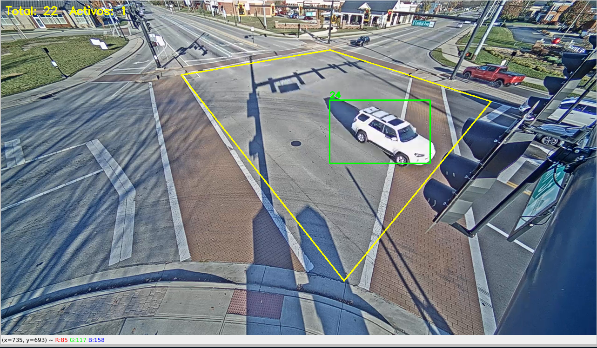
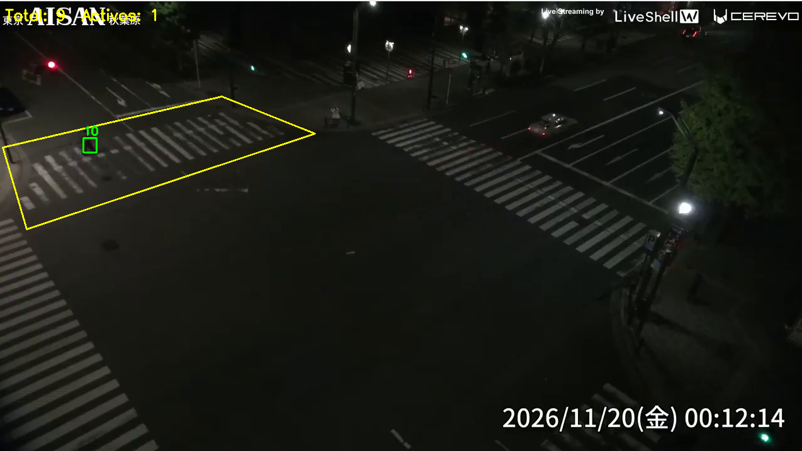
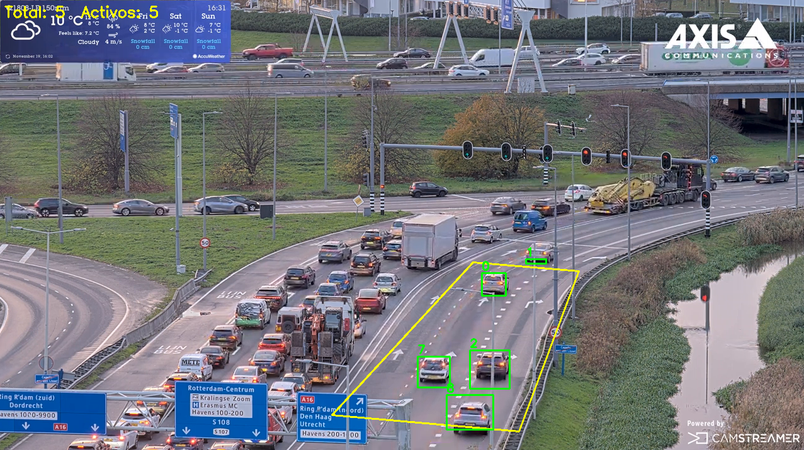

***



---
# Object Detection and Tracking for Streaming Vigilance Systems 

Sistema de visión por computador capaz de detectar, rastrear y contar objetos (como vehículos en un cruce) visibles desde una cámara fija emitiendo en vivo, utilizando técnicas clásicas de procesamiento de video.

El objetivo es detectar y rastrear objetos (como vehículos, personas, animales, etc.) en directo mediante emisiones en vivo, de forma que:
* Cada vehículo conserve **un único ID** durante todo su recorrido.
* Cada vehículo se cuente **una sola vez**, sin inflar el total por re-adquisiciones.
* Se filtren falsos positivos por área y por confirmación en varios frames.

Pensado como base para gestión de tráfico peatonal, de vehiculos o de animales en zonas protegidas.

[](LICENSE)
[](https://github.com/josuviteri/Computer-Vision-Vehicle-Tracker/releases)
[](https://github.com/josuviteri/Computer-Vision-Vehicle-Tracker/graphs/contributors)


## Origen de los Datos

* **Fuente:** cámaras de vigilancia públicas en directo (YouTube / HLS), por ejemplo las disponibles en [webcamtaxi](https://www.webcamtaxi.com/).
* **Ejemplo:** cruces de tráfico, zonas peatonales, bosques....
* **Condiciones:** perspectiva fija con iluminación variable, tráfico continuo y movimientos de cámara ocasionales por viento. COmo las emisiones son en vivo, las condiciones de captura pueden variar, y con ello, los resultados del sistema.

## Metodología y Tecnología

Se opta por un enfoque clásico por requisitos académicos, pero una versión destinada a producción implementaría sistemas basados en redes convolucionales profundas y arquitecturas transformers (CNNs y ViTs). 

Tres fuentes de información se combinan y cada una responde a una pregunta distinta:

| Componente | Pregunta que responde |
|---|---|
| **Sustracción de fondo (MOG2)** | ¿Dónde hay algo moviéndose? |
| **KCF / CSRT** | ¿Dónde está *este* objeto? |
| **Filtro de Kalman** (velocidad constante) | ¿Dónde *debería* estar según su movimiento previo? |

La idea clave es que *un objeto no desaparece de repente*: si KCF falla en un frame, el track no se elimina, sigue avanzando con la predicción de Kalman y puede recuperarse al volver a ser detectado.

### Elección del tracker
Se evaluaron los trackers de OpenCV (`BOOSTING`, `MIL`, `TLD`, `MEDIANFLOW`, `GOTURN`, `MOSSE`, `CSRT`, `KCF`). Se usa **KCF** por defecto por su equilibrio entre velocidad y precisión, **CSRT** está disponible con `--tracker CSRT` (alrededor de un 30% más preciso, 3 veces más lento).

### Frecuencia de detección (`--detect-every`)
Con el filtro de Kalman activo, se proponen estos valores de partida (a ~30 fps):

| Tracker | `--detect-every` | Rango | Motivo |
|---|---|---|---|
| **KCF** | 3 | 2–4 | Rápido pero no muy robusto a los cambios de escala. |
| **CSRT** | 6 | 5–10 | Más robusto frente a cambios de escala y oclusión parcial, por lo que mantiene un buen bounding-box más tiempo. |

- Kalman rellena huecos y suaviza el tracking, pero solo es un modelo de movimiento (no corrige escala ni apariencia). Por encima de ~10 frames de velocidad constante falla en frenadas y giros.


## Estructura del Proyecto

```
src/
  main.py          # Punto de entrada (CLI)
  stream.py        # Resolución de URL (yt-dlp) y lector de stream en hilo con prebuffer y reconexión
  roi_selector.py  # Selección interactiva del ROI (polígono) sobre el primer frame
  detector.py      # Sustracción de fondo + morfología -> lista de Detection
  tracker.py       # Track (KCF + Kalman) y TrackManager (asociación, ciclo de vida, conteo)
  analytics.py     # (pendiente) homografía, velocidad, dirección
  draw.py          # (pendiente) overlay / HUD
original_experiments/   # Enfoques iniciales (referencia)
PLAN.md                 # Plan de mejora por fases
```

## Instalación

```bash
python -m venv .venv && source .venv/bin/activate
pip install -r requirements.txt
```

> Se requiere `opencv-contrib-python<5` ya que OpenCV 5 ya no incluye KCF.

## Uso

```bash
python src/main.py
```

| Argumento | Descripción | Por defecto |
|---|---|---|
| `--url` | URL del vídeo/directo a procesar | https://www.youtube.com/watch?v=Jy1Y9f8NEY0 |
| `--fps` | FPS de reserva si el stream no informa los suyos | `30` |
| `--detect-every` | Extraer detecciones cada N frames | `3` |
| `--tracker` | Tipo de tracker: `KCF` o `CSRT` | `KCF` |
| `--roi` | JSON con el ROI: se carga si existe, y si no se selecciona con el ratón y se guarda | — |
| `--serve` | Puerto en el que mostrar la ejecución, para poder verlo en el buscador en lugar de abrir una ventana opencv | — |

Sin `--roi`, al ejecutarse, primero se pide seleccionar el ROI clickando las cuatro esquinas de un rectangulo.

Pulsa `q` en la ventana o `CTRL + C` en la terminal para salir.

### ROIs predefinidos

En `configs/` hay ROIs ya seleccionados para los tres streams propuestos:

| Escena | URL | ROI (`--roi`) |
|---|---|---|
| Carretera 1 | https://www.youtube.com/watch?v=Jy1Y9f8NEY0 | `configs/carretera_1.json` |
| Cruce 2 | https://www.youtube.com/watch?v=4cA_-WAm-SE | `configs/cruce_2_1.json`, `configs/cruce-2_2.json`, `configs/cruce_2_3.json` (dos pasos de peatones y un cruce) |
| Cruce 3 | https://www.youtube.com/watch?v=2juLrCH5w9U | `configs/cruce-3.json` |

```bash
python src/main.py --url https://www.youtube.com/watch?v=4cA_-WAm-SE --roi configs/cruce_2_1.json
```

### Ver el resultado desde el navegador

Es necesario tener un archivo de configuracion en formato JSON guardado previamente, se puede crear usando --roi , sin --serve

```bash
python src/main.py --roi configs/nombre_roi.json
```
Desplegar: 
```bash
python src/main.py --serve 8000 --roi configs/carretera_1.json
# abrir http://localhost:8000
```


Se detiene con `CTRL + C`.

## Lógica del Sistema

1. **Stream:** `StreamReader` resuelve la URL con `yt-dlp`, lee en un hilo y entrega los frames a ritmo constante (FPS del vídeo) tras un prebuffer inicial, reconecta si el stream se corta.
2. **ROI:** el usuario selecciona un polígono sobre el primer frame, el procesamiento se limita a esa zona.
3. **Detección:** MOG2 se actualiza en **todos** los frames, los contornos se extraen solo cada `--detect-every` frames (apertura + cierre morfológico). Se filtra por área mínima/máxima **relativa al tamaño del frame**. Los primeros 100 frames son de calentamiento del modelo de fondo (sin detecciones).
4. **Predicción y seguimiento:** en cada frame, Kalman predice la posición y KCF la actualiza. Si KCF falla o da un salto incoherente con la predicción, se suma un fallo y se usa la posición de Kalman.
5. **Asociación:** en los frames de detección se asignan detecciones a tracks con el **algoritmo húngaro** (coste = 1 − IoU contra la posición *predicha*). Una detección emparejada corrige Kalman y **reinicializa KCF** (evita la deriva). Una detección sin emparejar intenta primero **recuperar un track `LOST`** cercano (conserva el ID) y, si no hay ninguno, crea un track nuevo.
6. **Ciclo de vida:** `TENTATIVE` → `CONFIRMED` tras 3 aciertos (solo estos se dibujan y cuentan) → `LOST` tras 10 fallos → eliminado tras 60, si sale del ROI o si es un falso positivo de pocos frames.
7. **Duplicados:** dos tracks con IoU > 0.6 durante 3 frames se fusionan conservando el ID más antiguo.
8. **Conteo:** un vehículo se cuenta una única vez, al pasar a `CONFIRMED`.

## Visualización

Sobre el vídeo se dibuja el ROI, el bounding box y el ID de cada vehículo confirmado, y un contador con el **total** y los vehículos **activos**.

## Fases del Proyecto

- Fase 0 — Lectura de streaming en directo (hilo, prebuffer, reconexión)
- Fase 1 — Selección interactiva del ROI
- Fase 2 — Tracking robusto (KCF + Kalman + húngaro, ciclo de vida, conteo único)
- Fase 3 — Analítica: homografía, velocidad, dirección y trayectorias (`analytics.py`, `draw.py`)
- Persistencia del ROI por cámara, grabación de clips y evaluación cuantitativa (ver [PLAN.md](PLAN.md))

## Limitaciones Conocidas

* **Oclusiones:** aglomeraciones de vehículos muy próximos pueden fusionarse en una sola detección e incluso transferirse entre objetos manteniendo el ID al salirse uno de ellos del ROI.
* **Maniobras bruscas:** pueden hacer fallar a KCF, se mitiga con Kalman y la recuperación de tracks `LOST`.
* **Iluminación:** la sustracción de fondo es sensible a cambios fuertes de luz y a movimientos de cámara, aunque en los streams propuestos no se esperan. Uno de los mayoras limitantes es la deteccion de objetos pequeños (como personas vistiendo de negro) en una imagen oscura (brillo reducido). Uno de los streams propuestos trata de un cruce en Japón, el cual se encuentra 5 horas adelantado respecto a nuestro horario, por lo que es un buen ejemplo para probar el algoritmo en un paso de peatones en condiciones de visibilidad reducida.  
* **Sombras:** Se ha observado que las sombras que aparecen por la tarde y la luz de los faros por la noche, se incluyen como parte de los objetos en movimiento y se incluyen en los bounding-boxes, lo que resulta en detecciones de areas superiores a lo que sería el objeto.
* **Latencia:** el prebuffer del stream introduce un retraso fijo de unos segundos respecto al directo.
* **Calidad:** Dependiendo del algoritmo de tracking elegido y cada cuantos frames se actualiza, la calidad de los resultados puede mejorar o detectar el mismo objeto varias veces.

## Referencias

* Bradski, G. and Kaehler, A. *Learning OpenCV: Computer Vision with the OpenCV Library*. O'Reilly Media.
* Documentación oficial de OpenCV.
* S. S. Sahar, "Object Tracking Using KCF Algorithm." *International Journal of Computer Applications*, 2020.
* Material docente de Procesamiento de Vídeo, Universidad de Deusto.

---
*Josu Viteri | 2026/11*
